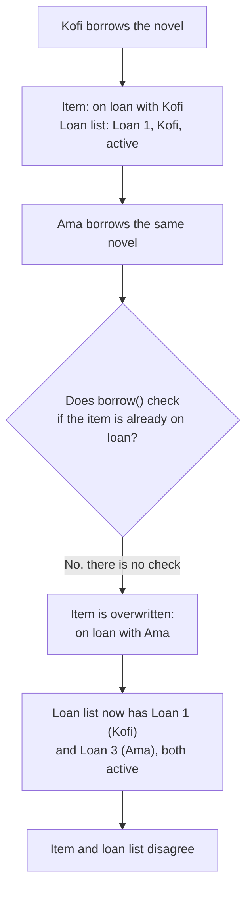
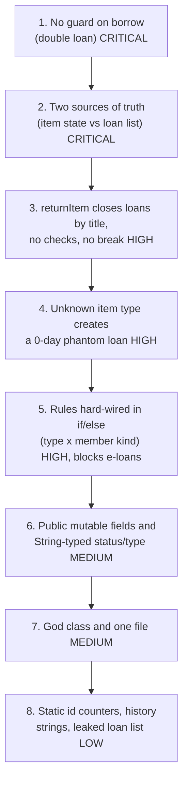
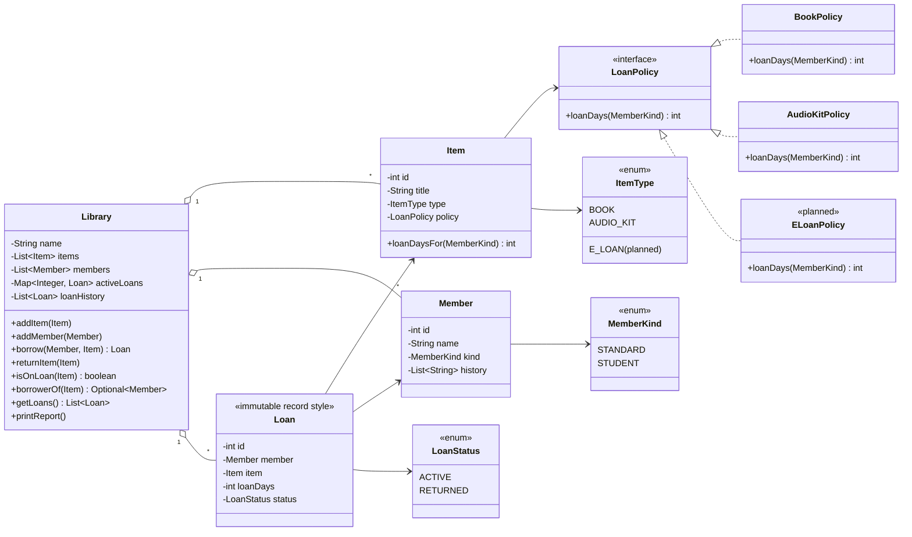
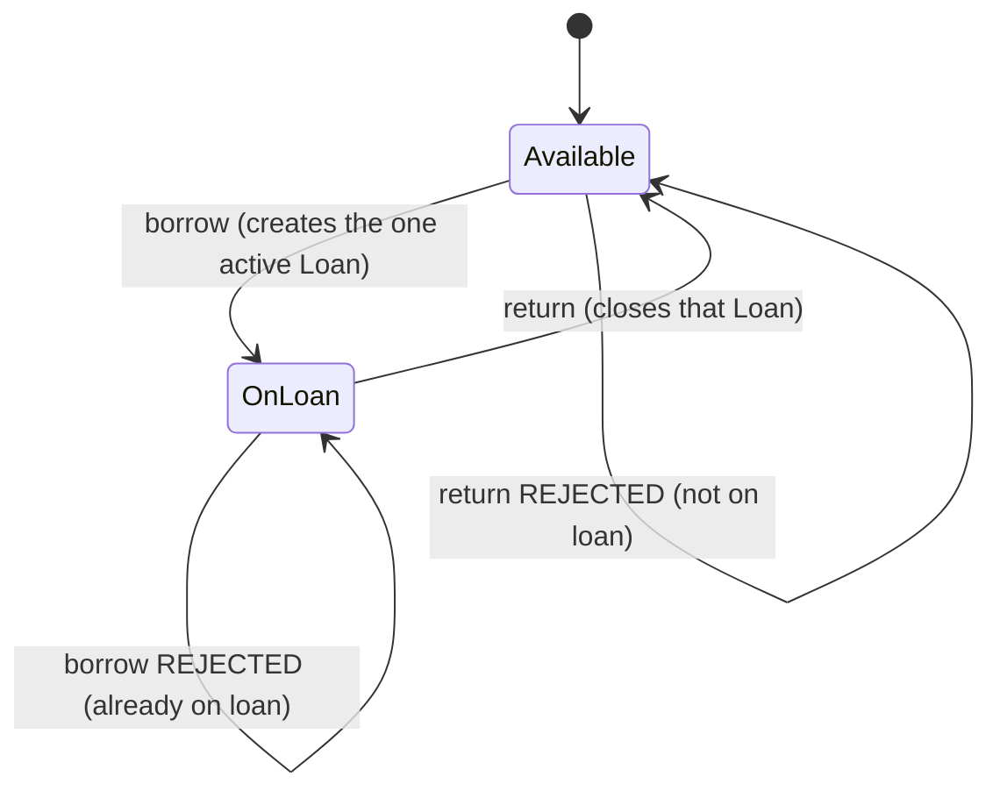
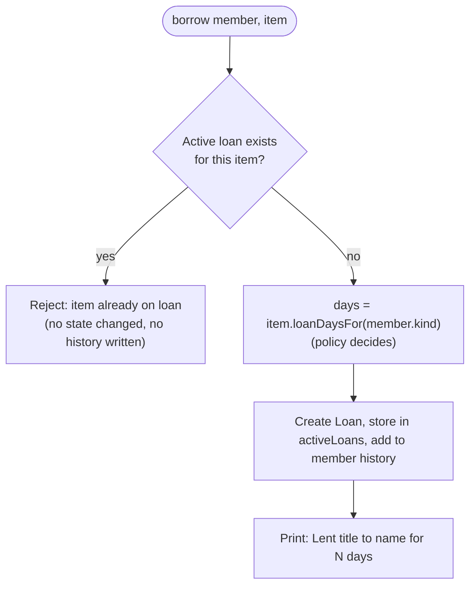

# The Reading Room: My diagnosis

This file was committed before any code change. It holds the diagnosis of the starter code and a sketch of the structure I plan to build.

## 1. What the starter code does today

This is what `LendingTracker.main` prints. It is the behavior I have to preserve, apart from the one rule the business wants enforced.

```
Lent "Things Fall Apart" to Kofi Mensah for 14 days
Lent "French Audio Course" to Ama Owusu for 14 days
Returned "French Audio Course"
Lent "Things Fall Apart" to Ama Owusu for 28 days

=== The Reading Room - end of day ===
Items:
  "Things Fall Apart" (BOOK): ON_LOAN - with Ama Owusu
  "French Audio Course" (AUDIO_KIT): AVAILABLE
Active loans:
  Loan #1: "Things Fall Apart" -> Kofi Mensah
  Loan #3: "Things Fall Apart" -> Ama Owusu
```

The loan periods the code uses, which must stay identical:

| Item \ Member | STANDARD | STUDENT |
|---|---|---|
| BOOK | 14 days | 28 days |
| AUDIO_KIT | 7 days | 14 days |

The report contradicts itself. The novel is listed as with Ama, but the active loans name both Kofi and Ama, and nothing in the program noticed.

## 2. How the double loan happens



## 3. Problems found, ranked by danger to this business



### 1. `borrow()` never checks whether the item is already on loan (most dangerous)

`Library.borrow` sets the item to `ON_LOAN` and overwrites `currentBorrower` without looking at the current status. The rule that an item can only be on one loan at a time exists nowhere in the code. It depended on volunteers behaving.

A library is a record of who has what. If two members are both told they hold the same copy, one of them is wrong, and the library cannot say who to chase for the missing item. The earlier borrower also loses their record, because the item no longer shows them. That is the "item on loan to two members" symptom the volunteers describe. For a volunteer-run library that runs on trust, a ledger nobody can rely on makes the tool useless, so this ranks first.

### 2. The same fact is stored in two places

The item holds `status` and `currentBorrower`, and `Library.loans` holds a `Loan` with its own `status`. Neither is derived from the other. Every code path has to update both by hand, and any path that updates one and forgets the other creates a contradiction, as section 2 shows.

This is what hides problem 1. It also explains why changing the audio-kit rules once broke book returns: the rules, the item state and the loan bookkeeping are tangled together, so touching one disturbs the others.

### 3. `returnItem()` is unsafe

It never checks that the item is on loan, so returning an `AVAILABLE` item still prints "Returned". It also finds loans by title string instead of by item or loan identity, and the loop has no `break`. After the double loan from problem 1, a single return closes both Kofi's loan and Ama's, so a copy can be marked back while someone still holds it. Two different items with the same title would collide the same way.

The business risk is that items can disappear from the records, which makes problem 1 worse.

### 4. Unknown item types create a phantom loan

If `type` is neither `"BOOK"` nor `"AUDIO_KIT"`, for example a typo like `"Book"`, no branch in `borrow()` runs. `loanDays` stays 0 and the item stays `AVAILABLE`, but the history entry and an `ACTIVE` loan of 0 days are still recorded, and the volunteer sees no message.

The cause is free-form `String` types and an `if / else if` chain with no `else`. The result is a loan on file for an item that still looks available.

### 5. Business rules are hard-wired into `Library.borrow()`

The loan periods are nested `if (type) { if (member kind) }` blocks, copied once per item type, inside the class that also handles lending, history and bookkeeping. The rules should belong to the item type.

This matters because e-loans are coming. Adding them under the current design means another branch in `borrow()`, probably changes to `returnItem()` (an e-loan may expire instead of being returned), and changes to the report, all in the method that holds the critical rule. That is how the audio-kit change broke book returns, and it would happen again.

### 6. Public mutable fields and string-typed state

`title`, `type`, `status`, `currentBorrower`, `history`, and the `items` and `members` lists are all `public`. `status`, `type` and `kind` are plain Strings such as `"ON_LOAN"` and `"STUDENT"`. Anything can set `item.status = "on loan"` with no validation, and the compiler cannot catch a typo, so invalid states are easy to create from outside the class.

### 7. One file, one oversized class

`Library` handles storage, lending rules, loan bookkeeping, history and reporting, and every class sits in one file. Nobody can change one part without reading all of it, which is why new volunteers are told not to touch it.

### 8. Smaller issues

These get fixed along the way and need no separate effort:

- The `static int counter` ids are global shared state that cannot be reset and is not thread-safe.
- `Loan` stores `memberName` and `itemTitle` strings instead of references, so two members with the same name look identical.
- `getLoans()` returns the live internal list, so callers can change the library's records.
- `member.history` is a public `List<String>` that grows even when a borrow fails (problem 4).
- There are no tests, so "behaves the same" cannot be proven today.

## 4. Planned structure

The main idea is to make the invalid state impossible to represent, so the rule does not have to be checked in many places.

1. An item is on loan only if the library holds an active `Loan` for it. Availability and borrower are derived from that and never stored separately. This fixes problems 1 and 2.
2. The library keeps active loans in a `Map<itemId, Loan>`. A map key holds one value, so a second loan on the same item cannot exist. `borrow` also rejects it with a clear message.
3. Loan-period rules live in a `LoanPolicy` for each item type instead of in `Library`. This fixes problem 5 and makes e-loans an addition instead of an edit.
4. Enums replace strings, fields become `private`, and the loan list is returned unmodifiable. This covers problems 4, 6 and 8.

### Class diagram



### Item lifecycle



### Borrow flow after the rebuild



## 5. Keeping the behavior the same

- The console messages (`Lent "..." to ... for N days`, `Returned "..."`) and the report format stay exactly as they are.
- The loan-period table in section 1 stays identical, with a small test for each cell (book and audio kit, standard and student).
- I will run the original `main` scenario against the old and new code and compare the output.
- One difference is intended. The final `borrow(ama, novel)` is now rejected, so Loan #3 is never created and the report shows the novel with Kofi only. That is the single rule the business asked to enforce.

## 6. Planned improvement beyond the brief

I plan to add an automated JUnit test suite that locks in the loan-period table and the one-loan-per-item rule. It gives the reviewer proof that behavior is preserved, and it gives the next volunteer a safety net when e-loans are added. That speaks directly to the fear that changing one thing breaks another. The full justification will go in the README design notes.

If the design changes while I build, I will record what changed and why in those notes.
