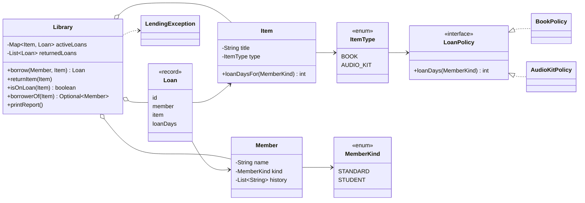

# The Reading Room — Community Library Lending Tracker

This is the starter repository for the **Java Basics** applied lab. Read the lab
brief alongside this repository; it explains the business, what you are being
asked to deliver, and how your work is assessed.

## What this is

A small program The Reading Room uses to track what is borrowed. It works, but it has become risky to change. Your task is to diagnose it
and rebuild it well — **not** to change what it does, but to make it safe to
change and impossible to leave in an invalid state.

## Running it

The program is plain Java (no external dependencies). You need JDK 21.

**With Maven:**

```bash
mvn compile
mvn exec:java -Dexec.mainClass=LendingTracker
```

**Or directly with the JDK:**

```bash
javac -d target/classes src/main/java/LendingTracker.java
java -cp target/classes LendingTracker
```

Run it first, before you change anything, so you can see how it currently
behaves. Look carefully at the end-of-day report.

## What to hand in

See the lab brief for the full list: a written diagnosis, your rebuilt version
(behaving exactly as the original does today), a short note on your key design
decisions, and one improvement beyond the brief. You will talk through your work
in a live review.

#
# Additional Context

A rebuild of the volunteer-written lending tracker. It does what the original did, with one change: an item can only ever be on one loan at a time. The written diagnosis and the first design sketch are in `DIAGNOSIS.md`.

## Running it

Java 21 is needed.

```
mvn test                                   # runs the tests
mvn compile exec:java -Dexec.mainClass=LendingTracker
```

Or without Maven:

```
javac -d out src/main/java/*.java
java -cp out LendingTracker
```

`legacy/LendingTracker.java` The path to the original program, kept so the two can be compared side by side.

## Structure



Each file has one job. `Library` is the ledger. `Item` and `Member` describe things and people. `Loan` is a fixed record of one loan. The loan rules live in `BookPolicy` and `AudioKitPolicy`, and `ItemType` picks the right one.

## Design decisions

### One source of truth for "on loan"

In the original, an item stored its own status and borrower, and the library kept a separate loan list with its own statuses. The two could disagree, and that is how the double loan went unnoticed. Now `Item` has no status at all. `Library` keeps active loans in a `Map<Item, Loan>`, and "is it on loan" and "who has it" are answered from that map. A map key holds one value, so a second active loan for the same item cannot exist, and `borrow` refuses with a clear message before it would try.

I considered keeping a status field on `Item` and adding an `if (status == ON_LOAN)` check in `borrow`. That fixes the one bug but leaves two places to keep in sync, so the next change could break it the same way.

### A loan never changes

`Loan` is a record. When an item comes back, the loan moves from the active map to a list of returned loans. There is no status string to get wrong, because which collection holds the loan says whether it is active.

### Refusals are exceptions, and nothing changes when one happens

A refused `borrow` or `returnItem` throws `LendingException`, a checked exception, so a caller cannot ignore it by accident. The library changes nothing before it throws. Tests confirm that a refused borrow leaves the borrower, the member history and the loan numbering untouched.

### Rules belong to the item type

The loan period for each type of item sits in its own small class, and `ItemType` owns the policy for its type. I chose this over subclasses such as `Book extends Item` because the items do not behave differently. Only the rules differ, and a policy object keeps that to one small class. The switch expressions in the policies have no default branch, so adding a new kind of member stops the code compiling until someone says what that member gets. I left `LoanPolicy` unsealed because a `permits` list would be one more place to edit when a new kind of item arrives, for no gain.

### Encapsulation and modern Java

All fields are private. Lists handed out by `Library` and `Member` are read-only, and the loan lists are copies. Enums replace the strings for type and member kind, so a typo is a compile error instead of a silent 0-day loan. `Loan` and the policies are records, the policies use switch expressions, and the library returns an `Optional` for the borrower lookup.

## How this makes e-loans easy to add

With this structure, a new kind of item means:

1. Write `ELoanPolicy implements LoanPolicy`.
2. Add one constant to `ItemType`: `E_LOAN(new ELoanPolicy())`.

`Library`, `Member`, `Loan`, the report and the one-loan rule stay as they are. I tried this on a throwaway copy: two files changed, and an e-loan item could be lent, refused when already out, and shown in the report. The loan period I used there was a placeholder, since the brief does not give one.

The original would have forced changes in several places. `borrow()` needs a third copy of the nested type and member-kind branches, and since an unrecognized type silently creates a 0-day loan, a missed branch would fail without any message. `returnItem()` and the report would need a look too, because they all share the same string types. Those edits sit in the method that holds the most dangerous rule, which is how the audio-kit change once broke book returns.

One question is open for the library. If an e-loan could be borrowed by several people at once, which is common for digital items, the one-loan rule would need to move into the policy. I kept the current rule for every item because the brief says an item can only ever be on one loan at a time. The library should confirm what e-loans allow before that feature is built.

## Changes from the first sketch in DIAGNOSIS.md

- Active loans are keyed by `Item` instead of an item id. Items no longer have ids, because nothing in the program used them. Loan numbers are kept and are assigned by the library.
- There is no `LoanStatus` enum. A loan is active if it is in the active map and returned if it is in the returned list, which removes one more way to hold an invalid status.
- `ItemType` owns the loan policy. The sketch had `Item` hold it, which allowed a mismatched type and policy.

## Behavior preservation

I ran the original and the rebuild and compared their output. The outputs are saved in `docs/`.

Normal afternoon, with the double borrow removed from the original, matches the rebuild line for line. The expected text in `LibraryTest.normalAfternoonPrintsExactlyWhatTheOriginalPrinted` was checked against `docs/original-output-normal-afternoon.txt`.

The full original scenario, compared with the rebuild (`diff docs/original-output.txt docs/new-output.txt`), differs in exactly the intended places:

```
4c4
< Lent "Things Fall Apart" to Ama Owusu for 28 days
---
> Cannot lend "Things Fall Apart" to Ama Owusu: already on loan to Kofi Mensah
8c8
<   "Things Fall Apart" (BOOK): ON_LOAN - with Ama Owusu
---
>   "Things Fall Apart" (BOOK): ON_LOAN - with Kofi Mensah
12d11
<   Loan #3: "Things Fall Apart" -> Ama Owusu
```

The loan-period table (book 14 or 28 days, audio kit 7 or 14 days) is checked by `LoanPolicyTest`. The report format, the `Lent` and `Returned` messages and the loan numbering are unchanged.

Two things behave differently from the original, both on purpose. Returning an item that is not on loan now fails with a message instead of printing "Returned". Returning an item closes only that item's loan, where the original closed every loan with a matching title.

## Improvement beyond the brief: an automated test suite

The tests in `src/test` do three jobs.

- They lock in the loan-period table and the original output, so a volunteer who changes a rule sees at once if something else moved. The volunteers' fear is that one change breaks another, and this answers it directly.
- They protect the rule the business cares about most. Tests cover a refused double borrow, a refused borrow leaving no trace, re-lending after a return, and returns closing only the right loan. I removed the guard from `borrow` on a scratch copy and the three tests for that rule failed.
- They are the starting point for e-loans: the person adding them copies a policy test and a borrow test.

I checked the tests here with a small stand-in for the JUnit annotations, because the build environment could not download JUnit. All 14 passed, but I have not run `mvn test` itself, so run it once on your machine.
